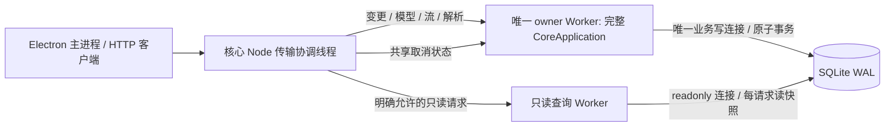

# 本地发布期间核心响应性：只读架构评审

日期：2026-10-11。范围：读取冻结源码、已安装依赖及既有验收证据，只新增本文件和独立证据；未修改产品、访问实时数据库、执行模型请求、重新入库大文件或操作 GUI。本文件是后续设计建议，**没有实现或验证响应性修复**。

## 结论

推荐将完整 `CoreApplication` 和 `CoreIpcAdapter` 放在现有核心 Node 子进程中的唯一 owner Worker；该 Worker 保留唯一业务写连接、全部同步事务、队列、hooks、模型调用、解析调用和用量记录。外层 Node 线程保留 HTTP/私有 fork IPC 传输、请求生命周期和健康检查；独立只读 WAL 查询 Worker 处理明确审查过的 GET 子集。取消通过核心内部的共享原子状态到达同步发布批次，随后由 owner 回滚并持久化真实取消结果。

这个方向可避免逐个把现有同步写 API 改成异步，却仍需修改应用入口、只读初始化、私有认证、响应/流桥接、发布检查点和关停恢复。它不是把 `publish_local` 包上一层 `await`，也不是增加一个 SQLite 写 Worker 后保留主线程继续写。当前约 6.7 秒的同步发布仍然是明确限制，不能据此宣称已通过性能验收。

## 已有测量能证明什么

真实 Orca 无模型上传证据是 [live health 记录](../refactor-evidence/20261011-root-model-free-large-live-health.json)：2,880,000 字节、40,000 行；根记录 15,439 ms，纯分块 Worker 阶段 4,053 ms，`publish_local` 6,676 ms。24 次健康观察中 21 次 HTTP 200、3 次约 3 秒超时；成功样本最大 949.391 ms。这次真实运行与 Windows 干净构建并行，只有一次上传，不能计算或声称 P95。

发布阶段 UTC 为 `11:51:23.345` 至 `11:51:30.021`。前两次超时请求始于 `11:51:23.404382`、`11:51:26.920198`；第三次始于 `11:51:30.440894`，已晚于记录中的发布结束。因此，代码和时间重叠支持“同步发布能阻塞核心”，但不能把三个超时全部归因于这一阶段，也不能把观测工具等待或构建耗时当作业务耗时。

另一份已完成的隔离 3.2 MB 测量 [分 SQL 计时](../refactor-evidence/20261011-root-fts-sql-timing/command.json) 表明：175 批 FTS INSERT 合计 3,221.971 ms，175 批 DELETE 合计 138.735 ms，11,200 次注册 UPSERT 合计 109.880 ms。它与上述真实运行的文件/环境不同，不可直接拼成后者的精确时间分解。FTS 已按 64 ID 批量删除/插入；本建议不再提出已实施的批处理，不改 tokenizer、标题/context/正文、召回或 DELETE 写入语义。

[SPEC](SPEC.md) 和 [PLAN](PLAN.md) 要求单一写者、真实取消/恢复、真实页面和性能测量，没有给页面响应或取消指定数字预算。后续实现需要先记录明确的验收目标与采样条件，不能从当前样本虚构预算。

## 当前阻塞与原子性边界

| 代码位置 | 核实的行为与影响 |
| --- | --- |
| [database.ts](../../packages/core/src/storage/database.ts)，`transaction` 第 133 行 | `better-sqlite3` 的同步 `immediate()` 事务；拒绝 AsyncFunction/thenable。嵌套事务使用驱动 SAVEPOINT。 |
| [pipeline.ts](../../packages/core/src/documents/pipeline.ts)，第 184–219 行 | `async` 阶段包装最终进入同步 `pub`：退役旧索引和块，插入父/子块与邻接信息，更新完整来源 metadata，发布 FTS。 |
| [workflow.ts](../../packages/core/src/documents/workflow.ts)，`publish` 第 285 行 | 发布前重验文档写权限、KB、当前 `workflow_job_id` 和取消状态。 |
| [queue.ts](../../packages/core/src/jobs/queue.ts)，`publish` 第 88 行 | 先取得写事务，再检查 running/attempt/ownerToken/lease/cancel fence；回调同步执行。 |
| [search-index.ts](../../packages/core/src/retrieval/search-index.ts)，`indexKeywords` 第 74 行 | 64 ID 一批，真实同步 `.run()` 执行 FTS DELETE/INSERT；精确全局 rowid、来源/权限和旧向量校验已经存在。 |
| [http.ts](../../packages/core/src/adapters/http.ts)，第 115、128、165 行 | HTTP handler、无需查询的 `/health` 和业务 dispatch 在同一个核心事件循环。 |
| [desktop-process.ts](../../packages/core/src/tools/desktop-process.ts)，第 80、91 行 | 私有进程消息处理与应用同线程；普通 cancel 消息只 abort 对应传输请求。 |

现在本地发布的块、FTS、来源 metadata 等在同一外层事务中提交，外部 SQLite 连接不会看见未提交的半成品。新向量、摘要、Wiki、图谱等后续阶段仍按现有各自发布边界执行；本建议不把这些阶段虚称为一个总事务。

Electron renderer 已与核心 Node 子进程分离，浏览器/Electron 可以继续绘制；问题是等待 IPC/HTTP 核心回复的功能会停顿。当前纯分块 Worker 解决计算线程阻塞，不能迁移 SQLite 发布。只在批次间 `await setImmediate()` 会违反现有同步事务契约；若强行保持事务打开，其他 handler/heartbeat/用量写入可能加入同一连接的事务，或者读到内部半成品。分批 COMMIT 则破坏原子可见和取消回滚。两者均不采用。

## 三种方案比较

| 方案 | 可行范围 | 必须付出的代价 | 判断 |
| --- | --- | --- | --- |
| 完整应用 owner Worker + 独立只读查询 | 保留现有同步 callbacks、单连接、事务、权限、hooks 和队列；独立 GET/健康检查可并发读旧的已提交状态 | 新的请求/流/私有 session 边界、只读构造路径、取消检查点；owner 内模型/流回调仍会受同步发布阻塞 | 推荐作为当前最小可信架构改造 |
| 全业务单写命令服务 + 异步数据层 | 能进一步把模型/解析编排留在独立响应线程，把数据库工作集中到写者 | 域命令、事务批次、所有直接写入与 finally/heartbeat/hook API 都要改；不能跨 Worker 发送现有闭包 | 长期方向，当前不是小补丁 |
| 保留现有线程，驱动层改异步或中断 | 若使用另一驱动/原生接口，可能分离 SQLite 执行 | 当前 `better-sqlite3` JS/type/native 导出没有 interrupt/progress-handler API；新原生桥接和 Windows ABI/关闭风险 | 没有当前依赖依据，不推荐 |

独立证据的静态扫描在 39 个文件找到 425 处 `db/database/sqlite` 调用匹配，包括 prepare、pragma、backup、transaction；它是语法下界，不是“425 个写入点”的完整审计。完整应用方案可把这些同步调用留在同一个 isolate，确实减少逐 API 改造。

## 推荐布局与初始化



现有正式运行是 [runtime.cjs](../../desktop/runtime.cjs) 的 `child_process.fork`，`serialization: 'json'`，入口为 `core/dist/tools/desktop-process.js`；当前行为已不是早期 SPEC 中写的 utilityProcess。保留这个已验证外部传输，只在其 Node 子进程内部增加 owner/query Worker。SAB 不经过现有 JSON fork 通道，renderer 只发送现有受校验的请求或取消。

不能直接把 `desktop-process.ts` 作为 Worker 入口：它要求 `process.send`，监听父进程 `message`/disconnect/OS 信号。必须拆出由 `parentPort` 驱动的 owner 入口，外层继续维护 fork 协议。HTTP 入口也应依赖有类型的异步 dispatch/authorize facade，而不再直接持有可写 `CoreApplication`。上传在外层的有界解析和 owner 端现有权限校验都保留。

只读服务必须等 owner 完成 schema/bootstrap，再以现有 `openNativeDatabase(path, { readonly: true, fileMustExist: true })` API 开连接。保留 safe integers、同一 schema JSON/boolean 解码、FK 查询语义及必要的 sqlite-vec 扩展加载；不运行迁移、`journal_mode=WAL` 设置、业务 DDL 或恢复。readonly 不等于文件系统沙箱，WAL/shm 的运行条件也要实际验证。

以下现有初始化不能在只读服务中重复：

| 入口 | 实际副作用或拥有的状态 |
| --- | --- |
| `CoreDatabase` 第 94 行 | 创建数据目录、开可写连接、配置 WAL/NORMAL/FK、加载 sqlite-vec、运行迁移，构建 drizzle。 |
| `CoreApplication` 第 189 行 | 可能写入 `service.identity`；启动设置应用连接 timeout；创建写服务、注册 handlers；随后 documents/jobs recovery、`chat.recoverActors` 及 lease 等待定时器会写数据库。 |
| `SearchIndex` 构造器 | 创建 retrieval sequence/registry/vector entry/build 表；`KnowledgeDomain` 未传 index 时也会创建它。 |
| `EvaluationService` 第 35 行 | 初次实例化会 `recoverGeneration`，把失去确认的付费生成标记 interrupted；还注册队列 handlers。 |
| `ChatService` 第 39 行 | 创建/使用队列、stream/journal，并注册三个队列 handlers，拥有 callbacks、claims 和后台任务映射。 |
| HTTP server 初始化 | 持久化 CSRF secret；该写入也应由 owner 初始化一次，不能让协调线程成为额外写者。 |
| `CoreIpcAdapter` | 恢复加密 session；auth 操作通过私有 `#epoch` 仲裁，save 会写 session。 |

因此应抽取真正的 `ReadDatabase` 能力（get/all/read/同步读 snapshot），让审查过的 Auth/Knowledge/Settings 查询和注册 handler 接受它；写 service 保持 `CoreDatabase`。当前类带私有成员、直接要求具体可写类型，不能用强制类型转换把只读连接伪装成完整类。`SearchIndex` 需分离 schema 初始化与查询能力，或给明确不做 DDL 的可信内部读构造路径。不要为了注册 GET 再调用完整 `registerKnowledgeRoutes(CoreApplication)`，因为它现在会创建 DDL index 并同时注册变更路由。

## 只读 GET 复用审查结果

分流必须按精确 method + 已解析路由模板 allowlist，保留原有路径校验、匹配顺序、参数解码和完整 DTO。未审查的路由默认留 owner；GET 不是只读证明。

| 路由/方法 | 只读分析 | 首版建议 |
| --- | --- | --- |
| Auth `me`/`listDevices` | 当前 fresh user/tenant/device/membership 验证及读取，无写入 | 允许；与路由查询在同一快照认证 |
| Knowledge/KB list/detail/stats/chunks/tags/move-targets/search | 完整读 `knowledge/index.ts`、`knowledge-bases.ts`、domain；这些 GET 无变更。keyword/source filtering、完整正文及 metadata 语义必须保留 | 允许；排除下载/媒体；提供不做 DDL 的依赖 |
| Model/Settings 的列表、详情、用量、凭据状态、KV/provider/integration 配置投影 | GET 是 DB/已存凭据的读取和脱敏；不会测试模型或发送网络请求 | 允许审查后的具体模板；不输出私有密钥 |
| Startup 配置 GET | `StartupConfiguration.projection` 同时返回 saved 文件与构造时 active snapshot | 需要 owner 的 active/env 快照；不能用 query Worker 新构造值冒充正在运行的配置 |
| Wiki list/detail/folders/index/search/graph/stats/log/lint/issues | 完整读 service/internal；`lint` 第 266 行只是计算，`issues` 第 272 行读取持久化状态，`stats` 调用它们也不写。GET `index` 与写入用的 `rebuildIndex` 是不同方法 | 可第二批加入；保留整请求 snapshot，避免把 defaultFolder/write helper 当 GET 依赖 |
| Chat continue-stream GET | [chat/index.ts](../../packages/core/src/chat/index.ts) 第 226 行 `stream` 调用 `streams.ensure`；循环 `reconcile` 可 finish 消息/流、更新 actors、写 journal。[streams.ts](../../packages/core/src/jobs/streams.ts) 第 8 行 `ensure` 真正 INSERT | 必须留 owner；不是只读查询 |
| Chat 普通 list/detail/messages/events/actors/context-usage | 这些方法本身读取；contextUsage 读取 history，不生成 snapshot。trajectory 还依赖 observability 投影；整个 ChatService 构造器会注册 handlers | 初版留 owner；后续抽出完整读取能力再审查，不能直接初始化第二 ChatService |
| System parser-engines GET | `SystemDiagnostics.parserEngines` 第 23 行调用 `parser.capabilities()`，可能启动 Python，并在 await 后再验权限 | 留 owner |
| System storage/info GET | 检查 PRAGMA/完整性、FTS/vec 与文件；`info` 调用 storageStatus | 初版留 owner或另行设计；query connection 的 timeout/FK 等不是 owner connection 状态，不能直接替代原结果 |
| Langfuse status / MCP tools GET | [integrations/index.ts](../../packages/core/src/integrations/index.ts) 的 `langfuseStatus` 第 252 行真实网络 health；`listMcpTools` 第 319 行连接 MCP、列工具、创建/关闭远程 session，并维护 active/client 清理状态 | 留 owner；不是纯 WAL 读取 |
| Graph/evaluation/public embed/legacy 等 GET | Graph 可能发 Neo4j；Evaluation 初始化会恢复任务，状态/报告还依赖 freshness/file/public dataset helpers；public embed 有独立 origin/grant 权限 | 不按整个模块放行。本轮没有完成其每个间接依赖的完整只读证明，保持 owner |

复用应优先拆出共享 GET 注册函数和查询域能力，不复制一套 DTO/权限代码。既有敏感内容投影、租户与 KB 一致性、来源区间/哈希、全局精确 64-bit rowid、FTS/vec 共享身份和旧向量处理都保留。不要引入跨请求结果缓存。

## 认证、快照和请求顺序

只读路径必须自行基于可信 transport binding 重新执行现有 `authenticateAccess`/legacy bearer/API key 和 `assertCan`，然后执行业务范围检查。不能接收 renderer 构造的 AuthContext，也不能每次等待 owner `authorize()`；后一种做法仍会在发布期间阻塞。

HTTP cookie/bearer/origin/CSRF/host 校验继续在可信传输层，私有凭据只能进入内部 Worker 通道。IPC 凭据目前藏在 `CoreIpcAdapter.#session`，`invoke` 不返回 authChange；所以只读服务不能“自然复用”它。建议共享受控的私有 session/epoch 状态，或每个读 snapshot 加载并解密已提交的 `desktop_meta['ipc.session']`，同时由协调器处理 auth 操作的 epoch 和迟到响应。读取已存在的 vault key不生成新 key；凭据、native tickets/cookies 均不得回给 renderer 或写入证据。

当登录/退出/refresh/change-password开始或 session 替换时，协调器同步提高私有 epoch，阻止旧 epoch 的延迟只读结果回到界面；owner 仍保留现有 authOperation 仲裁与 superseded issue 撤销语义。pending auth期间可暂缓/明确拒绝同会话的新只读请求，不能从旧的角色或 membership 镜像判权限。单纯读持久化 session 不覆盖“新退出已收到但尚未提交”的竞态。

一个 GET 的认证、ID 列表、行/元数据、统计与来源校验必须在 query Worker 的同一个**同步 deferred 读事务**中完成。每条 SELECT 单独执行可能先读旧 IDs，owner COMMIT 后再读新 metadata，混成不存在的文档版本。读事务内禁止网络 await 和写入。只读连接复用但每个请求重新取快照、重新认证。

并发发布时只读服务可能返回完整旧的已提交版本；发布未提交前应继续显示已提交的 workflow/阶段状态。mutation 回复必须在 COMMIT 之后发送，await 该回复再 GET 应得到对应或更新版本。若需要“已收到的所有先前 mutation 必须先完成再 GET”，则应显式加顺序屏障，但那类 GET 会主动等待发布，不能同时承诺即时返回最新内容。

## 请求、上传、二进制和流桥接

`CoreRequest`/`CoreResponse` 是可 structured-clone 的 JSON DTO；`PrivateBinding`、signal、upload、stream/cookie 不在普通请求里。不得直接把 `CoreApplication`、数据库句柄、functions、AsyncIterable 或 AbortSignal 当 workerData 传递。

| 字段/行为 | 必需的内部桥接 |
| --- | --- |
| request id/body/path/tenant | 两端校验 DTO 与现有限额；协调器 request id 与业务 request id 的关系保持，worker 不提供任意 SQL/函数入口 |
| HTTP PrivateBinding / IPC IpcOptions | 固定可信格式，不接受 renderer access/AuthContext 注入；IPC auth/session仍由 owner adapter掌握 |
| upload Uint8Array | 保留 64 MiB 限额、文件名/字节与 owner 权限校验。用专属 ArrayBuffer 转移或有界 copy，不转移 Node pooled Buffer 的共享 backing store；不把 renderer 路径变成能力 |
| signal | 每调用 owner 新建 AbortController；协调器转发 cancel/close 和已取消状态。message 不能在同步发布中触发监听，所以真实 job cancel另用共享状态 |
| CoreBinary/CoreCookieResult | structured clone 不保留类 identity；内部显式判别 response/binary/cookies，再由外层重建现有传输结果。cookie 仅交可信 cookie store/HTTP header |
| CoreStream.frames | owner 消费 iterator，按现有 sequence + ACK/backpressure 桥接 opened/frame/end/error；保存 after_offset 恢复语义，断开必须 return iterator并取消传输生命周期 |
| nativeLangfuse | 私有 plan/ticket/cookie 走既有独立 capability；不可合并进普通 renderer invoke响应 |

ACK、流超时与关闭的等待可由协调线程管理，但模型 HTTP 回调、解析消息、provider timeout、owner 的 stream pump仍在 owner事件循环；它们在同步发布期间仍可能停顿。完整应用方案首先解决外层存活、明确的只读页面与取消控制，而不能单独证明“并行聊天流无停顿”。若那也是硬性目标，就需要后续进一步隔离模型/流编排或实施单写命令服务。

## 真正取消：同步检查点、回滚与提交竞态

当前 [queue.ts](../../packages/core/src/jobs/queue.ts) 第 72 行的 `cancelByRequest` 要先在同一连接写持久化取消，再 abort 执行 controller；[workflow.ts](../../packages/core/src/documents/workflow.ts) 第 250 行的文档 cancel也更新元数据并等待 handlers。普通 `marlin:cancel`/fork cancel只取消调用，不是 cancel-parse。迁入 Worker 后若取消仍只是 `postMessage`，同步 FTS期间监听器一样不能执行。

可行的最小控制方案：

1. owner为每个真实 claim/attempt发放有界、不可复用的内部取消槽，绑定 jobId/attempt/ownerToken/doc/tenant/generation，不向 renderer暴露 SAB。协调器根据可信会话，在只读快照中验证现有写权限、文档范围与已提交 claim后，才对该槽进行原子取消。排队/尚未注册的目标继续遵守现有 request-id早停逻辑；不能拿旧槽取消新一轮解析。
2. 外层有界控制通道立即能接收请求，但“收到取消”只是 pending。owner在发布入口、旧块退役循环、insertMany flush、rowid注册/FTS 64-ID批次、长 CPU循环和 callback出口检查共享取消/期限；抛出受识别的错误，让**整个现有 outer transaction回滚**。所有来源/权限、attempt/ownerToken/lease与 workflow_job_id校验保留，在最终边界再验。
3. 在 rollback结束后，由唯一 owner执行 `cancelByRequest`、步骤/根记录/span终止和当前文档 workflow projection，abort真实模型/解析 controller，完成文件补偿，再回复现有“cancelled”结果。只有已持久化终态可以报告取消成功。coordinator不能开第二写连接抢写 cancel。
4. 在真正 COMMIT前用共享状态 CAS仲裁：取消先取得状态则回滚；owner先将 ACTIVE改为 COMMITTING则这次发布获得提交资格，随后取消不能承诺撤销已发布版本，只能取消后续工作。COMMIT失败仍要报告实际失败/回滚；完成回复前必须明确该次 publication的结果。此 CAS是提交资格的线性化点，不等于 SQLite COMMIT已经完成。

当前驱动无公开 SQLite interrupt/progress handler，当前 native statement与单次大 JSON运算不能被 JS共享标志抢占。取消最多等到下一个检查点，再支付回滚成本。64 ID/900参数限制的是条数/绑定数，不是毫秒上界；合法大 chunk仍可能让一条 SQL很慢。报告中的隔离 FTS statement最大约 74 ms不是通用取消 SLA，必须用目标平台实际验证。

共享 flag是进程内状态，不是持久化取消请求。若协调器在设置 flag后、owner终态落库前崩溃，不得认为已经保证取消。最小方案只在真实持久化后 ACK；如额外要求“接收瞬间即持久化、即使 owner事务长时间执行也不丢”，需要另行设计协调器的受控 durable取消日志和恢复，不是 SAB自动提供的能力。

不能用 `Worker.terminate()` 实现普通发布取消：它不能提供业务 rollback/终态 receipt保证，还会丢失整个应用的模型/解析/其他任务状态。只能作为关停失败的最后隔离措施；提交是否发生不确定时按恢复规则处理，不能假称已回滚。纯分块 Worker可终止的设计不可照搬到数据库 owner。

## 心跳、重启、关停和文件边界

JobQueue当前默认 lease 90 s、heartbeat 15 s；timer、timeout和回调仍在 owner内，同步发布时不会运行。新增检查点应同步检查取消、绝对deadline与现有 lease；不得靠协调器另开写连接续约，或任意延长所有 lease规避问题。若需长发布时续约，应由 owner在同一 claim下明确安排并测试，注意事务内续约直到 COMMIT才对只读连接可见。有限 Worker/任务并发、有界队列与队列等待截止时间也必须保留。

关停先停止接收新任务、把 owner已登记的取消/关闭槽置位，等待同步发布 rollback/完成，再在 owner内部执行现有 `application.close()`，关闭 parser/流/queued handlers和DB，最后终止 Worker。不要让协调线程调用 owner类对象的方法，也不要让等待ACK的流形成关停死锁。

Worker失联在“COMMIT后、reply前”可能有成功但客户端未知的结果。建议在同一发布事务中记录内部 publication receipt（job/attempt/source generation和结果），由恢复读取确认，保持现有safe/manual重启策略。模型付费结果仍不能自动重放。旧取消/迟到reply只能作用旧claim；doc当前 job pointer、source hash/generation和权限fence必须再次验证。

独立读快照与文件删除还有额外竞态：旧快照可能仍引用已经被 owner提交后退役的图片/原件。第一版只读 allowlist先覆盖 DB JSON页面，下载/媒体留 owner。若后续分流文件读取，必须加请求内文件 pin/受控读生命周期、哈希与作用域复验，不能用缓存或关闭hash检查消除问题。SQLite事务只保证数据库原子性，不保证外部文件生命周期。

## 独立可先实施的统计查询优化

root新增真实观察：有11,429个块的知识库在空闲时 GET也需要约1.51–1.64秒。这是root传递的实测结论，本轮未复测，不能将其与前述health样本合并成新的统计分布。

[KnowledgeDomain.kbDto](../../packages/core/src/knowledge/domain.ts) 第127行开始构造知识库DTO，第143行调用 `documents.flatMap(d => this.chunks(ctx, d))`。`chunks` 第41行先授权文档，再查块ID，随后为每个块 `db.read('chunks', id)`，读取/解码完整正文和metadata；最终只使用类型与行数。`KnowledgeService.stats` 第44行也为chunk_count hydrate全部块。这个浪费即使发布已经结束也会阻塞查询线程，迁入query Worker之后仍会拖慢该Worker的排队请求。

最小安全方向是只把这两个**统计用途**替换成等价范围的聚合读取，不改列出/编辑/检索块时所需正文：

```sql
SELECT count(*) AS total_chunks,
       coalesce(sum(CASE WHEN c.chunk_type IN
         ('text','image_ocr','image_caption') THEN 1 ELSE 0 END), 0)
         AS searchable_type_chunks
FROM chunks c
JOIN knowledges d ON d.id=c.knowledge_id
  AND d.tenant_id=c.tenant_id
  AND d.knowledge_base_id=c.knowledge_base_id
JOIN knowledge_bases b ON b.id=d.knowledge_base_id
  AND b.tenant_id=d.tenant_id
WHERE c.tenant_id=? AND c.knowledge_base_id=?
  AND c.deleted_at IS NULL AND d.deleted_at IS NULL
  AND b.deleted_at IS NULL;
```

必须先保留原KB/租户授权，再执行聚合。`kbDto.chunk_count`用searchable_type_chunks，`total_chunk_count`和`stats.chunk_count`用total_chunks。当前原计数**包括disabled块、disabled文档和parent类型**；searchableTypes只决定kbDto的可搜索类型数量，不代表实际启用的检索数。不能添加 `c.is_enabled`、`d.enable_status` 或source_generation条件，也不能把 `stats.chunk_count`改成只数子块。孤儿/跨tenant/跨KB块必须排除，空知识库为0。

保留原metadata/effective_chunking、last_strategy、processing和重建状态逻辑；它们仍需要读文档，不能靠删除正文或改变DTO缩短时间。回归要以真实隔离DB的parent/text/OCR/caption、disabled、已删、错误namespace、空集和旧元数据覆盖精确计数，另记录统计路径不再逐块读取/解码。SQL计划需核实实际索引，不预设任意数据量的时间上界。该优化减少读取成本，但**不解除发布的6.7秒同步写阻塞**，应独立验收。

## 可以逐步实施的边界

推荐路线分成以下阶段；每阶段源码/证据冻结后再进入下一阶段，不能把中间阶段当作全部响应性已通过。

| 阶段 | 实施边界 | 阶段结束前必须证明 |
| --- | --- | --- |
| 0：统计聚合 | 独立替换kbDto/stats计数hydrate，其他DTO和查询不变；drawer保存后的数量/关系刷新另做前端回归 | 等价范围和全部计数精确；不读块正文/metadata；相关core测试/typecheck和真实闲时GET采样 |
| 1：唯一owner与传输 | 拆出owner入口和类型化代理，把完整Application/IpcAdapter及所有写初始化迁入Worker；协调线程不创建CoreDatabase；HTTP/fork契约保持 | 只有一个RW连接；auth/cookie/binary/upload/stream/ACK协议与close/restart回归；真实Worker native DB/FTS/vec加载。此时健康可独立，但业务GET仍经owner，页面停顿未解决 |
| 2：独立查询 | 抽ReadDatabase与共享GET注册；owner bootstrap后开readonly WAL；第一批仅Auth/Knowledge/Settings明确模板；整请求auth+多SELECT读快照、IPC epoch、active配置镜像 | readonly路径不执行DDL/recovery/CSRF/session写；写事务中读完整旧版本、提交后读新版本；跨scope拒绝，auth切换迟到结果拒绝。未知GET仍owner，不放宽校验 |
| 3：真实取消 | 注册claim绑定SAB槽；所有长发布循环/SQL批次和出口检查；最终CAS仲裁，rollback后原owner持久化取消；close采用相同入口 | 发布实际运行时外部取消生效；取消赢和commit赢两种情况结果正确；没有部分块/FTS、错误成功ACK、旧attempt取消新任务；lease/deadline及崩溃receipt复验 |
| 4：正式目标平台与页面 | 编译Worker `.js`进入安装manifest；Linux与Windows官方Node/native extension/安装包验证；真实Orca和桌面同时入库、导航/列表/统计/取消 | 条件/采样数/耗时明确，已审查GET与控制通道满足选定预算；模型stream/解析回调的剩余owner阻塞单独测量和报告，不能用health成功代替 |

阶段1–3合起来才构成可靠的响应性架构；不能只搬完整应用Worker便完成交付。若不需要Wiki/Chat等额外只读路由，第一版可保守保留它们在owner；但这些页面发布期间仍会等待，这是明确范围限制，而不是默认已经改善。

若后续要求模型/流编排也持续响应，另一条单写命令服务路线需要更大、单独设计的迁移：

1. 审计实际调用图，定义具体域命令和原子事务单元（本地发布、模型用量/receipt、hook贡献、job claim/heartbeat/终态、auth/session等）；不可发送callback闭包或任意SQL。
2. 建立异步命令/回复与读snapshot接口；把当前 `publish<T>(() => T)`改为可序列化域命令和明确返回数据，将依赖同步返回结果的调用链连同后续验证改造。
3. 迁移队列progress/steps、定时心跳、cancel和恢复，以及模型finally用量、observability、Wiki/graph/memory callbacks；每个命令执行前/提交前继续重验scope/claim/source，失败补偿不遗漏。
4. 模型/解析/流编排留在独立响应线程，写actor拥有唯一RW连接。切换架构时同一运行实例只能选定一个写owner；不得临时让旧main和actor并行写。逐路由确认没有残留直接DB变更。
5. 与推荐路线同样完成共享取消/commit竞态、read-your-writes、backpressure、关停和commit后失联恢复，再跑完整相关回归、编译/Windows和真实页面验收。

此路线可进一步减少同步发布对provider/stream timers的影响，但需要系统性改变业务接口/回调语义，不能声称只修改pipeline或替换一个数据库类即可完成。当前正式Windows构建输入继续冻结，本报告不实施上述任何阶段。

## 必需验证与当前交付边界

本轮只检查文档链接、差异、输入/产品文件哈希和临时脚本清理，未运行新业务测试。未来实现至少需要：

- 真实 owner/query Worker + 隔离 WAL DB回归：发布中并发GET只能读完整旧版本；commit后读新版本；auth/多次SELECT处于同一snapshot；写权限撤销、跨tenant/KB、最大rowid与 FTS/vec精确来源保持。
- 真实同步批次取消：发布实际开始后从协调器设置flag；确认所有块/FTS/来源变更rollback，取消终态落库才ACK；覆盖取消/COMMIT双向竞态、排队早停、旧attempt、重解析、超时和关停。
- 桥接回归：cookie/IPCsessions/epoch竞态、上传边界、binary hash、stream seq/ACK/backpressure/断开/恢复、nativeLangfuse私有票据以及原HTTP/IPC校验。
- 源码 Worker、编译 `.js` Worker和目标Windows官方Node环境的真实 DB/FTS/sqlite-vec加载与关闭。当前better-sqlite3源码是 `NODE_API_MODULE`且按Napi environment创建Addon，但这不等于已验证Worker+Windows二进制；sqlite-vec实际通过 `loadExtension`加载平台 `.dll/.so`，同样需实测。
- core相关测试/typecheck、desktop传输/生命周期测试、受影响前端测试与正式构建；最终真实 Orca/Windows页面在无模型大文件发布时读取/切页/取消，并记录实际并行模型流限制。单测、纯计算Worker smoke或健康check成功均不能代替安装包/页面性能通过。

`tsconfig` 包含 `src/**/*.ts`，编译到 `dist`；新的 Worker模块应使用可证明的 import.meta.url/`.js`路径，并进入安装清单/hash。源码入口若需tsx bootstrap，也必须实际测试，不能假定父线程 execArgv能让Worker自动加载TS。外层与owner的受控env/StartupConfiguration active值一致；Worker不是系统沙箱。

独立可追溯结果在 [review evidence](../refactor-evidence/20261011-local-publication-responsiveness-review.json)。当前产品源码继续冻结：推荐方案尚未实现，没有新的延迟改善证据；现有约6.7秒发布期间核心响应缺陷保留为交付限制。
